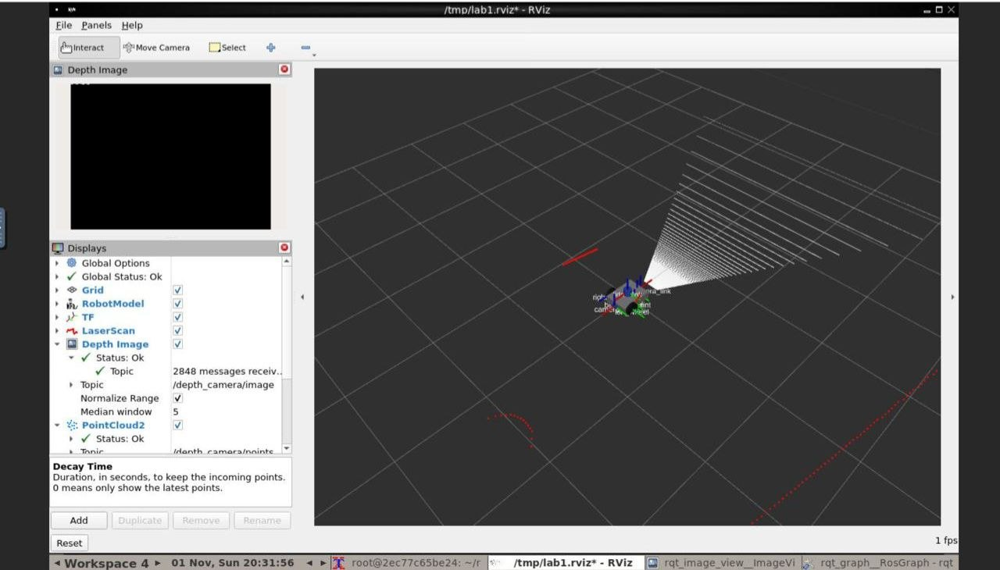
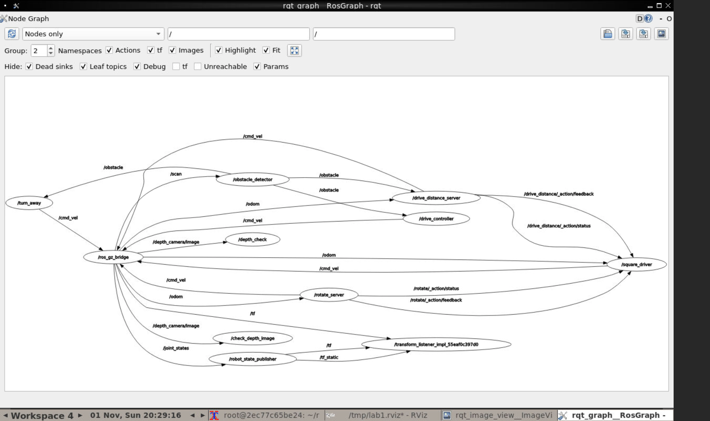

# Lab 1 – Introduction to Robotics and Intelligent Systems

This folder contains my completed Lab 1 implementation using ROS 2 Humble. The project implements a differential-drive robot with sensors, obstacle avoidance, custom ROS 2 interfaces, rotation control, and square-path driving.

## 1. Project Structure

The project contains four ROS 2 packages:

- **`diffdrive_bot`** – Differential-drive robot model, sensors, Gazebo world, launch files, and robot control components.
- **`lab_interfaces`** – Custom obstacle information message.
- **`my_robot_interfaces`** – Custom `RobotStatus` message, `SetTurnSpeed` service, and `Rotate` action.
- **`my_robot_nodes`** – Python nodes for obstacle avoidance, rotation, and square-path driving.

## 2. Requirements

- ROS 2 Humble
- Gazebo Harmonic
- ROS-Gazebo integration packages (`ros_gz`)
- `colcon`
- Dependencies declared in each package's `package.xml`

Ubuntu 22.04 is the recommended environment for ROS 2 Humble and Gazebo Harmonic.

## 3. Build Instructions

Clone this repository into the `src` directory of a ROS 2 workspace:

```bash
mkdir -p ~/ros2_ws/src
cd ~/ros2_ws/src
git clone https://github.com/Tsedalemariam/intro_robotics_intelligent_systems_labs.git
```

Navigate to the workspace:

```bash
cd ~/ros2_ws
```

Source ROS 2 Humble:

```bash
source /opt/ros/humble/setup.bash
```

Build the packages:

```bash
colcon build --symlink-install
```

Source the workspace:

```bash
source install/setup.bash
```

The `lab_01/COLCON_IGNORE` file prevents the original course examples from being discovered as duplicate packages. The completed implementation is located in `lab1_exercise/`.

## 4. Running the Project

### View the Robot Model

```bash
ros2 launch diffdrive_bot display.launch.py
```

### Launch the Simulation and Control Components

```bash
ros2 launch diffdrive_bot control.launch.py
```

### Run the Square-Driving Exercise

```bash
ros2 launch my_robot_nodes square.launch.py
```

The default square side length is 0.5 meters.

To use a side length of 0.8 meters:

```bash
ros2 launch my_robot_nodes square.launch.py side_length:=0.8
```

The square driver uses odometry to drive four sides and requests a 90-degree rotation after each side.

## 5. ROS Topics and Interfaces

| Topic | Purpose |
|---|---|
| `/cmd_vel` | Robot velocity commands |
| `/odom` | Robot odometry |
| `/imu` | IMU measurements |
| `/depth_camera/image` | Depth camera image |
| `/depth_camera/camera_info` | Camera calibration information |
| `/depth_camera/points` | Depth camera point cloud |
| `/obstacle` | Detected obstacle information |
| `/robot_status` | Custom robot status |

Use the following command to inspect available topics:

```bash
ros2 topic list
```

### Obstacle Avoidance

The `turn_away` node subscribes to `/obstacle`, publishes velocity commands to `/cmd_vel`, and publishes robot status.

The node starts disabled.

Enable obstacle avoidance:

```bash
ros2 service call /turn_away_enable std_srvs/srv/SetBool "{data: true}"
```

Disable obstacle avoidance:

```bash
ros2 service call /turn_away_enable std_srvs/srv/SetBool "{data: false}"
```

The custom `/set_turn_speed` service allows the turning speed to be changed, subject to the configured maximum.

### Rotation Action

The `rotate_server` node provides the `/rotate` action. It uses odometry to track angular movement and reports feedback while rotating. A zero-angle goal is rejected.

### Square Driver

The `square_driver` node uses the drive-distance and rotate actions to complete four sides of a square. The side length is configurable through the `side_length` launch argument.

## 6. Testing and Validation

The implementation was built successfully from a clean workspace using ROS 2 Humble. The following functionality was tested:

- Verified IMU messages and the IMU frame.
- Verified depth camera image, camera information, and point cloud topics.
- Checked sensor message rates, including the 10 Hz depth camera and 50 Hz IMU.
- Tested obstacle avoidance for obstacles detected on both the left and right.
- Tested enabling and disabling obstacle avoidance.
- Tested valid and invalid turning-speed service requests.
- Tested the rotation action with a positive angle and checked zero-angle rejection.
- Tested the drive-distance action.
- Successfully completed the square-driving exercise with the default 0.5 m side length.

## 7. Environment Limitations

Development and testing were performed using Docker on an Intel Mac.

- The Gazebo graphical interface could not run reliably because of OpenGL/GLX compatibility limitations. The simulation was run using the headless Gazebo server.
- Sensor topics and TF data were available for inspection.
- The RViz sensor visualization is included below. The RViz depth-image preview did not display correctly in this environment.
- The `rqt_graph` view sometimes required additional time for ROS graph discovery or a manual refresh before all nodes and connections appeared.

These limitations affected some visualization features, not the successful clean build or the separately tested ROS topics, messages, services, actions, and square-driving behavior.

## 8. Screenshots

### RViz Sensor Visualization



### ROS Computation Graph (rqt_graph)


